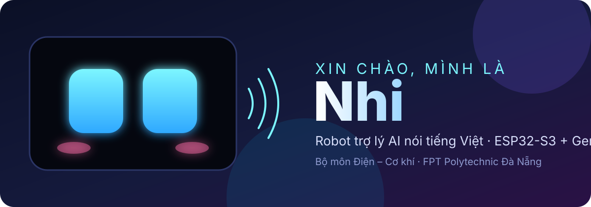
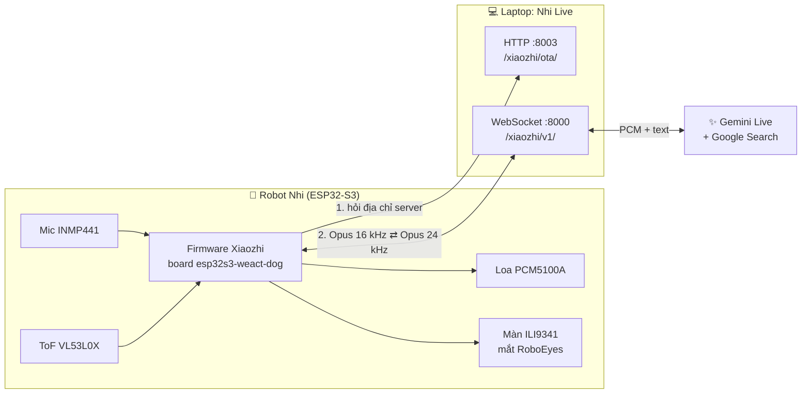
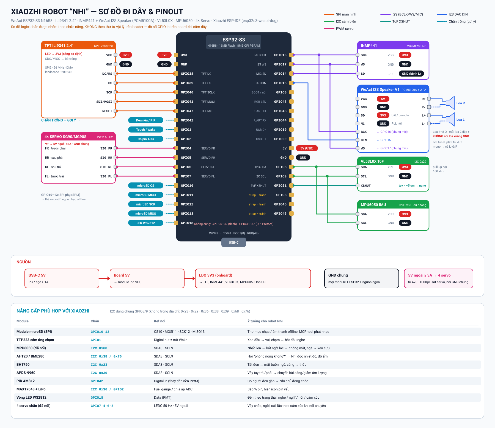

<p align="center">
  
</p>

<p align="center">
  <a href="https://huyhoa308.github.io/ai-robot/"><b>🌐 Trang giới thiệu</b></a> ·
  <a href="#-cài-đặt-từ-a-đến-z">🚀 Cài đặt</a> ·
  <a href="#-phần-cứng">🔌 Phần cứng</a> ·
  <a href="#-xử-lý-sự-cố">🛠️ Sự cố</a>
</p>

<p align="center">
  
  
  
  
  
</p>

**Nhi** là robot trợ lý AI để bàn, nói tiếng Việt, do sinh viên **Bộ môn Điện – Cơ khí, Cao đẳng FPT Polytechnic Đà Nẵng** chế tạo
cho **Ngày hội Chuyển đổi số phường Liên Chiểu (18/10/2026)**.

Nhi nghe – hiểu – tự tra Google – trả lời bằng giọng nói tự nhiên, với đôi mắt hoạt hình biết biểu cảm.
Gọi Nhi bằng câu **"Chào Nhi"**, bằng cách **đưa tay lại gần cảm biến**, hoặc bấm nút.

> Nhóm thực hiện: **Nguyễn Trung** · Giảng viên hướng dẫn: **thầy Trương Huy Hòa**

---

## ✨ Tính năng

| | |
|---|---|
| 🗣️ **Hội thoại tiếng Việt thời gian thực** | Google Gemini Live (`gemini-2.5-flash-native-audio`) nghe và nói trực tiếp, cho phép ngắt lời |
| 🔎 **Tự tra Google** | Tin tức, thời tiết, câu hỏi khó, kèm ngày giờ hiện tại để không trả lời thông tin cũ |
| 🎭 **Nhân vật riêng** | Tính cách trong `config.yaml`, kiến thức về trường, bộ môn, sự kiện trong `kien_thuc.md` |
| 👋 **Gọi không cần nút** | Wake word "Chào Nhi" chạy ngay trên chip (MultiNet) và cảm biến laser VL53L0X |
| 👀 **24 biểu cảm mắt** | RoboEyes trên màn ILI9341: vui, buồn, thả tim, Zzz, kính râm… kèm phụ đề |
| 📶 **Wi-Fi ổn định** | Tắt power save, buffer Wi-Fi trong PSRAM |
| 🎵 **Phát nhạc theo lệnh** | "Nhi ơi mở nhạc", "mở bài …": phát file trong thư mục `music/`; đưa tay vào cảm biến để dừng |
| 💸 **Miễn phí** | Server chạy trên laptop, dùng gói miễn phí Google AI Studio |
| 🧪 **Tự kiểm tra phần cứng** | Bộ test PlatformIO tự đọc log và báo linh kiện nào lỗi |

## 🧭 Kiến trúc



1. Khi bật, robot gọi **OTA URL** (`http://<IP laptop>:8003/xiaozhi/ota/`), server trả về địa chỉ WebSocket.
2. Robot gửi giọng nói (Opus 16 kHz, khung 60 ms) qua WebSocket. `bridge.py` giải mã và chuyển cho Gemini Live.
3. Gemini trả giọng nói (PCM 24 kHz) cùng chữ. Bridge nén lại thành Opus, gửi về robot kèm phụ đề và cảm xúc.

## 📁 Cấu trúc repo

```
ai-robot/
├── firmware/                 Firmware chatbot (ESP-IDF, nền 78/xiaozhi-esp32)
│   ├── esp32s3-weact-dog/    Mã nguồn board của Nhi (mắt, ToF, âm thanh, servo…)
│   ├── patches/              0001–0006: áp lên xiaozhi-esp32 @ c0fe42a bằng git am
│   ├── build_flash.ps1       Build + nạp trên Windows
│   └── docs/                 Kế hoạch, nhật ký test bản port đầu
├── server/
│   ├── nhi-live/             ⭐ Server chính: cầu nối robot ⇄ Gemini Live
│   └── nhi-server/           Server dự phòng: xiaozhi-esp32-server + Groq Whisper + Gemini + Edge TTS
├── hardware-tests/           PlatformIO: test toàn bộ ngoại vi, test mic, test loa
└── docs/                     Trang giới thiệu (GitHub Pages) + sơ đồ đấu dây
```

---

## 🔌 Phần cứng

| Linh kiện | Ghi chú |
|---|---|
| **ESP32-S3 WeAct N16R8** | 16 MB flash, 8 MB PSRAM (OPI) |
| **Màn hình ILI9341 2.4"** SPI 240×320 | Không cần chân MISO, LED nối 3V3 |
| **Mic INMP441** I2S | Nguồn **3V3** (đừng nối 5V hay GND!) |
| **WeAct I2S Speaker V1** (PCM5100A + 2 mạch khuếch đại) | Nguồn 5V, 2 loa |
| **VL53L0X** cảm biến khoảng cách laser | I2C, có chân XSHUT |
| 4 × servo SG90 (tuỳ chọn) | **Đang tắt** trong firmware (`DOG_SERVOS_ENABLED 0`) |

### Sơ đồ chân

| Linh kiện | Chân linh kiện → GPIO ESP32-S3 |
|---|---|
| ILI9341 | SCK→**40**, SDI/MOSI→**41**, CS→**39**, DC→**38**, RESET→**47**, SDO/MISO bỏ trống, LED→3V3, VCC→3V3, GND |
| INMP441 | SD→**14**, SCK→**16**, WS→**17**, L/R→GND, VDD→3V3, GND |
| WeAct I2S Speaker | DIN→**15**, BCK→**16**, WS→**17**, SD→3V3, MC→GND, VCC→5V, GND; loa vào R± và L± |
| VL53L0X | SDA→**8**, SCL→**9**, XSHUT→**21**, VIN→3V3, GND |
| Servo | FL→**7**, FR→**4** (servo 360°, không điều khiển), RL→**6**, RR→**5** |
| Có sẵn trên board | Nút BOOT→**0**, LED RGB→**48** |

> Mic và loa **dùng chung** BCLK 16 và WS 17 (một bus I2S full-duplex, 16 kHz, khe 32 bit).

<p align="center"></p>

---

## 🚀 Cài đặt từ A đến Z

Có 3 phần: **(A) server trên laptop**, **(B) nạp firmware cho robot**, **(C) cho robot kết nối tới server**.
Nếu robot đã có firmware thì bỏ qua phần B.

### A. Server Nhi Live trên laptop (Windows)

**Cần có:** Windows 10/11, Internet, một tài khoản Google.

1. **Lấy Gemini API key (miễn phí):** vào <https://aistudio.google.com/apikey> → *Create API key* → copy.
   Không gửi key cho ai và không đưa lên GitHub.
2. **Tải repo:** *Code → Download ZIP* rồi giải nén vào một thư mục **không có dấu tiếng Việt**, ví dụ `D:\ai-robot`.
   Nếu có git:
   ```bash
   git clone https://github.com/huyhoa308/ai-robot.git
   ```
3. **Chạy cài đặt:** mở `server\nhi-live`, chuột phải `setup.ps1` → **Run with PowerShell**.
   Nên mở PowerShell bằng **Run as Administrator** để script tự mở tường lửa. Script sẽ:
   - cài Python vào ngay thư mục `python\`, thư viện vào `.venv\` (không ảnh hưởng máy);
   - hỏi Gemini API key và lưu vào `config.yaml` (file này đã được `.gitignore` chặn);
   - mở cổng **8000 và 8003** trên tường lửa;
   - tạo shortcut **"Nhi Live"** trên Desktop.
4. **Chạy:** bấm đúp shortcut **Nhi Live**. Cửa sổ PowerShell hiện ra, **để nguyên cửa sổ đó**: đóng cửa sổ là Nhi ngừng nói chuyện.

   Nếu chưa có shortcut, chạy thủ công:
   ```bash
   powershell -ExecutionPolicy Bypass -File server\nhi-live\start_live.ps1
   ```
5. **Thử không cần robot:**
   ```bash
   server\nhi-live\.venv\Scripts\python.exe server\nhi-live\test_live.py gemini-2.5-flash-native-audio-latest "Xin chào Nhi"
   ```

> **Tự mở tường lửa (nếu script không làm được):** mở PowerShell **Admin** và chạy
> ```bash
> New-NetFirewallRule -DisplayName "Nhi Live (TCP 8000, 8003)" -Direction Inbound -Protocol TCP -LocalPort 8000,8003 -Action Allow -Profile Any
> ```

### B. Nạp firmware cho robot

**Cần có:** [ESP-IDF v6.0.1](https://docs.espressif.com/projects/esp-idf/en/stable/esp32s3/get-started/windows-setup.html), git, cáp USB.

```bash
git clone https://github.com/78/xiaozhi-esp32.git
cd xiaozhi-esp32
git checkout c0fe42a
git am ../ai-robot/firmware/patches/*.patch
python scripts/build.py esp32s3-weact-dog --language vi-VN
idf.py -p COM8 flash monitor
```

- `COM8` là cổng của robot: xem trong *Device Manager → Ports* (chip USB CH343).
- Hoặc dùng script có sẵn: `powershell -ExecutionPolicy Bypass -File firmware\build_flash.ps1 -Port COM8`.
- Chỉ sửa code và nạp lại app, **giữ nguyên Wi-Fi đã cài**: `idf.py -p COM8 app-flash`.

Các thông số hay chỉnh:

| Muốn đổi | File | Tên |
|---|---|---|
| Âm lượng mặc định (đang **100**) | `config.h` | `AUDIO_DEFAULT_OUTPUT_VOLUME` |
| Độ nhạy cảm biến tay | `dog_config.h` | `TOF_DROP_MM` (càng nhỏ càng nhạy), `TOF_NEAR_MAX_MM` |
| Bật/tắt servo chân | `dog_config.h` | `DOG_SERVOS_ENABLED` |
| Màu mắt, biểu cảm | `dog_config.h`, `dog_behavior.cc` | |
| Wake word | `config.json` | `"chao ni"` (phiên âm pinyin), ngưỡng `threshold` |

### C. Cho robot kết nối tới server

Robot và laptop phải **cùng một mạng Wi-Fi 2.4 GHz**. Có hai cách:

| Cách | Khi nào dùng | OTA URL |
|---|---|---|
| **Cùng Wi-Fi nơi tổ chức** | Có Wi-Fi ổn định | `http://<IP Wi-Fi của laptop>:8003/xiaozhi/ota/` |
| **Mobile hotspot của laptop** | Không có Wi-Fi tốt, laptop dùng 4G hoặc cáp mạng | `http://192.168.137.1:8003/xiaozhi/ota/` |

Xem IP laptop: chạy `ipconfig` và lấy dòng *IPv4 Address* của card Wi-Fi.
`start_live.ps1` cũng tự bật Mobile hotspot. Nên đặt hotspot ở **băng tần 2.4 GHz**.

**Cài Wi-Fi + OTA URL cho robot:**
1. Bật robot. Lần đầu robot tự phát Wi-Fi `Xiaozhi-XXXX`. Nếu robot đã có Wi-Fi cũ, **nhấn BOOT** lúc màn hình đang quét Wi-Fi.
2. Điện thoại kết nối Wi-Fi `Xiaozhi-XXXX`, mở trình duyệt vào **`http://192.168.4.1`**.
3. Chọn Wi-Fi (cách 1 hoặc 2 ở trên), nhập mật khẩu.
4. Mở phần *Nâng cao / Advanced*, ô **OTA URL** điền như bảng trên → **Lưu**. Robot tự khởi động lại.
5. Nói **"Chào Nhi"** hoặc đưa tay cách cảm biến khoảng 3 cm. Mắt Nhi chuyển sang trạng thái nghe là xong 🎉

> Robot nhớ Wi-Fi và OTA URL. Lần sau chỉ cần bật laptop (shortcut Nhi Live) rồi bật robot.
> Nếu laptop đổi IP (đổi mạng) thì phải cài lại OTA URL.

---

## 🎭 Tuỳ chỉnh nhân vật Nhi

Mọi thứ nằm trong `server/nhi-live/`. Sửa xong thì **chạy lại shortcut Nhi Live**, không cần nạp lại robot.

| Muốn đổi | Sửa |
|---|---|
| Tính cách, cách xưng hô, quy tắc trả lời | `config.yaml` → `prompt` |
| Kiến thức về trường, bộ môn, sự kiện, gian hàng | `kien_thuc.md` (chỗ ghi `[ĐIỀN]` là còn thiếu thông tin) |
| Giọng nói | `config.yaml` → `voice`: Aoede, Kore, Leda, Zephyr (nữ) · Puck, Charon, Fenrir, Orus (nam) |
| Bị cắt lời / chờ lâu mới trả lời | `config.yaml` → `silence_ms` (mặc định 500) |
| Tắt tra Google | `config.yaml` → `google_search: false` |

Nhật ký hội thoại nằm trong `server/nhi-live/bridge.log`: dòng `>>` là chữ Nhi nghe được, `<<` là câu Nhi trả lời.

### 🎵 Phát nhạc

1. Chép file `.mp3` / `.wav` / `.flac` / `.ogg` vào `server/nhi-live/music/`. **Tên file = tên bài** (có dấu cũng được).
2. Chạy lại shortcut **Nhi Live**.
3. Khách nói: *"Nhi ơi mở nhạc"* (Nhi tự chọn bài), *"mở bài Đà Nẵng mến yêu"*, *"Nhi có những bài gì?"*.
4. Dừng: đưa tay lại gần cảm biến, nói "Chào Nhi" hoặc bấm BOOT. Âm lượng nhạc: `music_gain` trong `config.yaml`.

Chỉ dùng nhạc bạn có quyền phát. Nguồn miễn phí: [Pixabay Music](https://pixabay.com/music/),
YouTube Audio Library, [Incompetech](https://incompetech.com/music/royalty-free/) (CC BY), [Free Music Archive](https://freemusicarchive.org) (chọn CC BY / CC0).
Thư mục `music/` không được đưa lên git. Thử không cần robot: `.venv\Scripts\python.exe toolsake_music.py`.

### Mang sang laptop khác

```bash
powershell -ExecutionPolicy Bypass -File server\nhi-live\make_package.ps1
```
Lệnh này tạo `dist\nhi-live-portable.zip` (không chứa API key). Trên máy mới giải nén rồi làm lại bước A3.

---

## 🧰 Server dự phòng `nhi-server`

Dùng khi không có Gemini Live: [xiaozhi-esp32-server](https://github.com/xinnan-tech/xiaozhi-esp32-server)
kết hợp Groq Whisper (nghe), Gemini Flash Lite (trả lời) và Edge TTS giọng `vi-VN-HoaiMyNeural`.
Repo này chỉ chứa **phần thay đổi**. Cách cài xem [`server/nhi-server/README.md`](server/nhi-server/README.md).

## 🧪 Kiểm tra phần cứng

Thư mục [`hardware-tests/`](hardware-tests/) là một dự án **PlatformIO (Arduino)**:

| Env | Làm gì |
|---|---|
| `test_all` | Test màn hình, I2C, ToF, IMU, mic, loa (loopback), LED, servo, Wi-Fi, nút BOOT. In bảng PASS / FAIL |
| `test_mic` | Thanh mức âm 2 kênh L/R, báo lỗi dây (không tín hiệu, đảo SCK/WS, SD hở) |
| `test_audio` | Phát nhạc và tiếng bíp 1 kHz, kiểm tra mic có nghe thấy loa không |

```bash
cd hardware-tests
powershell -ExecutionPolicy Bypass -File test_all.ps1 -RestoreXiaozhi
```

> ⚠️ Firmware test (Arduino) **xoá Wi-Fi và OTA URL** của chatbot. Test xong nạp lại chatbot rồi làm lại bước C.

---

## 🛠️ Xử lý sự cố

| Hiện tượng | Nguyên nhân thường gặp | Cách xử lý |
|---|---|---|
| Robot không phản hồi, log báo lỗi kết nối | Cửa sổ Nhi Live bị đóng | Bấm lại shortcut **Nhi Live**, đợi khoảng 30 giây |
| Robot không kết nối được (lỗi 113, timeout) | Tường lửa chặn, sai IP trong OTA URL, khác mạng | Mở cổng 8000/8003; kiểm tra `ipconfig`; robot và laptop cùng Wi-Fi |
| Robot không phát Wi-Fi cấu hình | Đã lưu Wi-Fi cũ | Nhấn **BOOT** lúc đang quét Wi-Fi |
| Mic không nghe | Dây VDD/SCK/WS sai | Chạy `test_mic`: SCK→16, WS→17, SD→14, L/R→GND, VDD→**3V3** |
| Loa không kêu | SD của module chưa lên 3V3, thiếu nguồn 5V | Chạy `test_audio` |
| Đưa tay không có phản ứng | Tay xa quá, cảm biến bị che | Đưa tay cách khoảng 2–4 cm. Nếu robot đang nghe, mắt sẽ **nháy** để báo đã thấy tay |
| Nhi nghe sai ở chỗ ồn | Tiếng ồn xung quanh | Nói cách mic 10–20 cm, câu ngắn |
| Báo hết lượt (quota, 429) | Vượt giới hạn gói miễn phí | Đợi vài phút hoặc đổi key khác |
| Nhi trả lời thông tin cũ | Không tra Google | Kiểm tra `google_search: true` |

Đọc log robot (cổng COM8, 115200 baud): `idf.py -p COM8 monitor`.

---

## 🙏 Ghi công và giấy phép

- Firmware dựa trên [78/xiaozhi-esp32](https://github.com/78/xiaozhi-esp32) (MIT).
- Mắt robot là bản port của [FluxGarage RoboEyes](https://github.com/FluxGarage/RoboEyes) (GPL-3.0-or-later,
  xem `firmware/esp32s3-weact-dog/LICENSE-RoboEyes.txt`), **nên firmware build ra theo GPL-3.0**.
- Server dự phòng dựa trên [xiaozhi-esp32-server](https://github.com/xinnan-tech/xiaozhi-esp32-server) (MIT).
- AI giọng nói: Google Gemini Live API.

<p align="center">Làm với ❤️ tại <b>Bộ môn Điện – Cơ khí · FPT Polytechnic Đà Nẵng</b></p>
